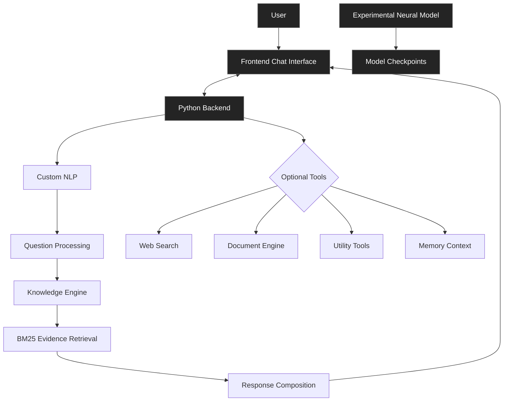

# MiniGPT

<div align="center">

### Experimental AI Chat Application

An experimental AI project exploring custom-built intelligence systems, natural language processing, knowledge retrieval, and neural language models.

<br/>

[](https://www.python.org/)
[](https://numpy.org/)
[](./LICENSE)
[](https://github.com/omarabualnasr/MiniGPT/commits/main)

[](https://github.com/omarabualnasr/MiniGPT/stargazers)
[](https://github.com/omarabualnasr/MiniGPT/forks)
[](https://github.com/omarabualnasr/MiniGPT/issues)

</div>

---

## Overview

MiniGPT is an experimental AI project focused on building and integrating custom artificial intelligence components into an interactive chat application.

The project combines custom Python-based processing, natural language understanding, evidence-based knowledge retrieval, and a separate experimental neural language model.

Rather than relying entirely on external AI services, MiniGPT explores how the underlying components of an AI system can be developed, understood, and integrated independently.

## Features

### Custom AI Engine

- Custom natural language processing.
- Intent detection and question analysis.
- Context-aware question handling.
- Knowledge retrieval and evidence ranking.
- BM25-based information retrieval.
- Evidence-grounded response composition.
- Compound question decomposition.

### Optional Tools

MiniGPT includes several built-in tools that can be enabled individually.

| Tool | Description |
|---|---|
| Calculator | Mathematical calculations |
| Unit Converter | Measurement conversions |
| Date & Time | Date and time information |
| Date Calculator | Date calculations |
| Scientific Math | Scientific and mathematical operations |
| Text Analyzer | Text analysis |
| JSON Tools | JSON processing |
| Web Search | Search the web and news |
| Document Reader | Retrieve information from uploaded documents |
| Memory Context | Persistent context and conversation history |

All tools are disabled by default and can be enabled when needed.

### Web Search

Optional web search functionality using DDGS, including dedicated news search.

- Web search and news retrieval.
- Source-based results.
- No search API key required by the included provider.
- Search rate limiting.

### Document Understanding

Upload documents and retrieve relevant information from their contents.

Supported formats:

`PDF` `DOCX` `TXT` `MD` `CSV` `HTML`

The document engine extracts content, organizes it into searchable sections, and retrieves relevant information in response to questions.

### Memory Context

A custom memory system for maintaining useful information across conversations.

- Persistent user context.
- Conversation history.
- Explicit memory commands.
- Contextual follow-up handling.
- Conversation recaps.
- Memory deletion.

Memory is configurable and enabled by default for local use. Hosted deployments disable it by default.

## Experimental Neural Language Model

The project also contains a separate experimental GPT-style neural language model implemented using custom Python and NumPy components.

Its architecture explores:

- Rotary Positional Embeddings (RoPE).
- RMS Normalization.
- Grouped Query Attention (GQA).
- SwiGLU feed-forward layers.
- Custom NumPy-based automatic differentiation.

**Important:** This is a separate AI experiment and is not currently connected to the chat application's response-generation pipeline.

## Architecture

The following diagram illustrates the main application components.



The neural-model experiment operates separately from the main chat processing pipeline.

## Technology Stack

<div align="center">


</div>

| Component | Technology |
|---|---|
| Backend | Python |
| Numerical Computing | NumPy |
| Frontend | HTML, CSS, JavaScript |
| NLP | Custom implementation |
| Retrieval | BM25-based custom engine |
| Web Search | DDGS |
| Neural Experiments | Python, NumPy |

## Getting Started

### Requirements

- Python installed.
- Windows for the included launcher.
- Internet connection for dependency installation and optional web search.

### Installation

Clone the repository:

```bash
git clone https://github.com/omarabualnasr/MiniGPT.git
cd MiniGPT
```

Install dependencies:

```bash
python -m pip install -r requirements.txt
```

### Run

On Windows, simply execute:

```text
Run Chat.bat
```

Alternatively, start the application manually:

```bash
python app.py
```

The local application will be available at:

```text
http://127.0.0.1:8000
```

## Project Structure

```text
MiniGPT/
│
├── AI Experiments/
│   ├── Tiny AI Engine/
│   ├── Custom NLP/
│   ├── Custom Reasoning Engine/
│   ├── Web Search/
│   ├── Document Engine/
│   ├── Memory Context Engine/
│   ├── Mini GPT/
│   └── ...
│
├── Frontend/
│
├── Run Chat.bat
├── app.py
├── requirements.txt
├── render.yaml
├── README.md
└── LICENSE
```

## Data & Privacy

MiniGPT supports local document storage and persistent memory.

- Local memory is stored on the local system.
- Uploaded documents are stored in the application's data directory.
- Optional tools are disabled until explicitly enabled.
- Hosted deployment settings disable document uploads, persistent memory, and teaching by default.

Always review the deployment configuration before enabling storage of user information on a hosted server.

## Deployment

The repository includes a `render.yaml` configuration for deploying the application using Render.

Hosted deployment settings are configured separately from the local environment.

## Project Status

**Experimental Development**

MiniGPT is an evolving project focused on exploring custom AI architectures, improving language processing, and developing a modular AI application.

Its components and capabilities may change as development progresses.

## License

Distributed under the MIT License. See [LICENSE](./LICENSE) for more information.

---

<div align="center">

**MiniGPT**

*Exploring artificial intelligence by building its components from the ground up.*

[Repository](https://github.com/omarabualnasr/MiniGPT) · [Issues](https://github.com/omarabualnasr/MiniGPT/issues)

</div>
