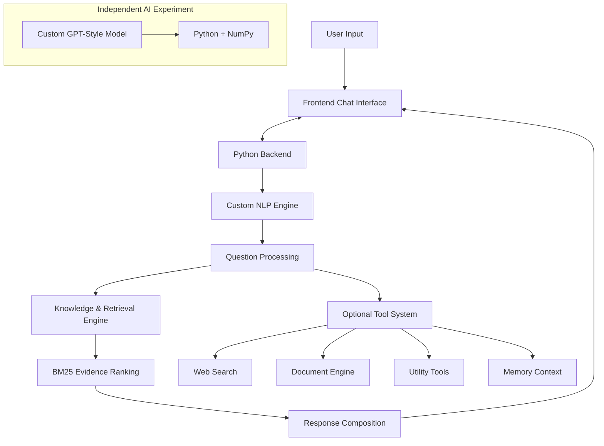

# <div align="center">MiniGPT</div>

<div align="center">

**Experimental AI Chat Application**

An experimental AI project exploring custom-built intelligence systems, natural language processing, knowledge retrieval, and neural language models.

<br/>

[](https://github.com/omarabualnasr/MiniGPT)
[](https://www.python.org/)
[](https://numpy.org/)
[](LICENSE)
[](https://github.com/omarabualnasr/MiniGPT/commits/main)
[](https://github.com/omarabualnasr/MiniGPT/stargazers)
[](https://github.com/omarabualnasr/MiniGPT/forks)

<br/>

[Overview](#overview) · [Features](#features) · [Architecture](#architecture) · [Installation](#getting-started) · [Technology](#technology-stack)

</div>

---

## Overview

MiniGPT is an experimental AI chat application focused on exploring how custom artificial intelligence components can be developed and integrated into a single interactive system.

The project combines custom natural language processing, question analysis, evidence-based knowledge retrieval, response composition, and optional utility integrations.

It also includes an independent experimental GPT-style neural language model implemented using Python and NumPy.

The main objective is to explore the underlying components of an AI application rather than depending entirely on an externally hosted language model.

> **Development Notice:** MiniGPT is currently in early development. Its components and capabilities are experimental and are not yet reliable or production-ready.

## Features

### 01. Custom Natural Language Processing

A custom NLP implementation designed to process and analyze incoming questions.

- Text normalization and tokenization.
- Light lemmatization.
- Typo correction.
- Intent detection.
- Keyword and phrase extraction.
- Question-focus extraction.
- Concept expansion.
- Context resolution.
- Compound-question analysis.

### 02. Custom Evidence & Retrieval Engine

A custom retrieval and response-composition system designed to identify relevant information from available knowledge sources.

- BM25-based evidence ranking.
- Compound-question decomposition.
- Topic inheritance.
- Evidence diversity.
- Focus-aware retrieval.
- Explicit taxonomy relationships.
- Shared document-passage ranking.
- Extractive answer composition.

**Important:** This is a custom retrieval and response-composition approach, not a general-purpose pretrained LLM.

### 03. Optional Built-in Tools

MiniGPT includes several tools that can be activated individually through the chat interface.

| Tool | Purpose |
|---|---|
| Calculator | Mathematical calculations |
| Unit Converter | Measurement conversions |
| Date & Time | Date and time information |
| Date Calculator | Date calculations |
| Scientific Math | Scientific and mathematical operations |
| Text Analyzer | Text analysis |
| JSON Tools | JSON processing |
| Web Search | Web and news retrieval |
| Document Reader | Document-based information retrieval |
| Memory Context | Conversation and user context |

All tools are disabled by default and can be enabled individually.

### 04. Web Search

Optional online search functionality powered by DDGS.

- Web search.
- Dedicated news search.
- External information retrieval.
- Search results integrated into the chat workflow.

Internet connectivity is required for this functionality.

### 05. Document Understanding

A document retrieval engine for extracting and searching information from uploaded files.

Supported formats:

`PDF` · `DOCX` · `TXT` · `MD` · `CSV` · `HTML`

Capabilities include:

- Document text extraction.
- Searchable document sections.
- Passage-based retrieval.
- Document-aware question processing.
- Document summarization and information lookup.

### 06. Memory Context

An experimental memory system designed to maintain useful information across conversations.

- Persistent user profiles.
- Conversation history.
- Explicit memory commands.
- Contextual follow-up handling.
- Pronoun resolution.
- Conversation recaps.
- Memory deletion.
- Per-user memory isolation.

Memory availability depends on the deployment configuration.

---

## Experimental Neural Language Model

MiniGPT also contains a separate GPT-style neural language model experiment developed using custom Python and NumPy components.

The experimental architecture explores:

| Component | Description |
|---|---|
| RoPE | Rotary Positional Embeddings |
| RMSNorm | Root Mean Square Normalization |
| GQA | Grouped Query Attention |
| SwiGLU | Gated Feed-Forward Architecture |
| Autograd | Custom automatic differentiation |

The experiment is maintained separately from the main chat application.

**Current limitation:** The experimental neural language model is not currently connected to the chat response-generation pipeline. The main application uses its custom NLP and evidence-retrieval system.

## Architecture

The following diagram illustrates how the main application components are organized.



The neural language model is an independent experiment and does not currently generate the application's chat responses.

## Technology Stack


| Layer | Technology |
|---|---|
| Backend | Python |
| Numerical Computing | NumPy |
| Frontend | HTML, CSS, JavaScript |
| NLP | Custom implementation |
| Retrieval | Custom BM25-based engine |
| Web Search | DDGS |
| PDF Processing | pypdf |
| Neural Model Experiment | Python + NumPy |

## Getting Started

### Requirements

- Python installed on Windows.
- Python launcher (`py`) available.
- Internet access for dependency installation and optional web search.

### Installation

**1. Clone the repository**

```bash
git clone https://github.com/omarabualnasr/MiniGPT.git
```

**2. Enter the project directory**

```bash
cd MiniGPT
```

**3. Start MiniGPT**

The easiest method is to run:

```text
Run Chat.bat
```

The launcher automatically installs the required Python dependencies and starts the application.

### Manual Installation

Install dependencies:

```bash
python -m pip install -r requirements.txt
```

Start the backend:

```bash
python app.py
```

Open the application at:

```text
http://127.0.0.1:8000
```

---

## Project Structure

```text
MiniGPT/
│
├── AI Experiments/
│   ├── Tiny AI Engine/
│   ├── Custom NLP/
│   ├── Custom Reasoning Engine/
│   ├── Mini GPT/
│   ├── Web Search/
│   ├── Document Engine/
│   ├── Memory Context Engine/
│   ├── Date Time Tool/
│   ├── Unit Converter/
│   └── ...
│
├── Frontend/
│
├── app.py
├── Run Chat.bat
├── requirements.txt
├── render.yaml
├── README.md
└── LICENSE
```

## Configuration & Deployment

MiniGPT supports local execution and includes a Render deployment configuration.

The following environment variables control selected capabilities:

| Variable | Purpose |
|---|---|
| `TINY_AI_ALLOW_DOCUMENT_UPLOAD` | Enable or disable document uploads |
| `TINY_AI_ALLOW_MEMORY` | Enable or disable persistent memory |
| `TINY_AI_ALLOW_TEACHING` | Enable or disable the teaching functionality |

The provided Render configuration disables document uploads, persistent memory, and teaching by default.

For local execution, memory and document upload settings can be configured independently.

## Development Focus

Current development is focused on improving the underlying system rather than presenting it as a finished AI product.

Areas of ongoing work include:

- Improving question interpretation and retrieval accuracy.
- Expanding and refining the available knowledge.
- Improving response relevance and consistency.
- Strengthening optional tool integrations.
- Developing and experimenting with custom neural architectures.
- Improving the overall application experience.

## Important Development Notice

**MiniGPT is in early development.**

This project is experimental, and its features are still being developed and tested.

- Some features may not work as expected.
- Some tools may return incomplete results or fail.
- The application may misunderstand questions.
- It may be unable to answer certain questions, or may fail to provide a meaningful answer to any given question.
- Responses may be inaccurate, incomplete, irrelevant, or inconsistent.
- The experimental neural language model is not yet integrated into the chat response pipeline.

MiniGPT should not be considered a reliable general-purpose AI assistant or a production-ready application.

The project is being developed and improved progressively, and its behavior and capabilities may change significantly over time.

## License

This project is licensed under the **MIT License**.

See the [LICENSE](LICENSE) file for the complete license text.

---

<div align="center">

**MiniGPT**

*Built through experimentation, exploration, and independent development.*

[GitHub Repository](https://github.com/omarabualnasr/MiniGPT)

</div>
